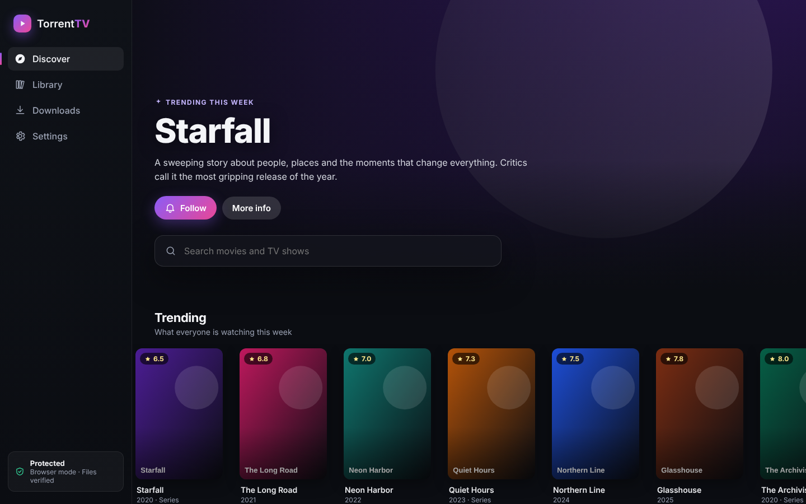
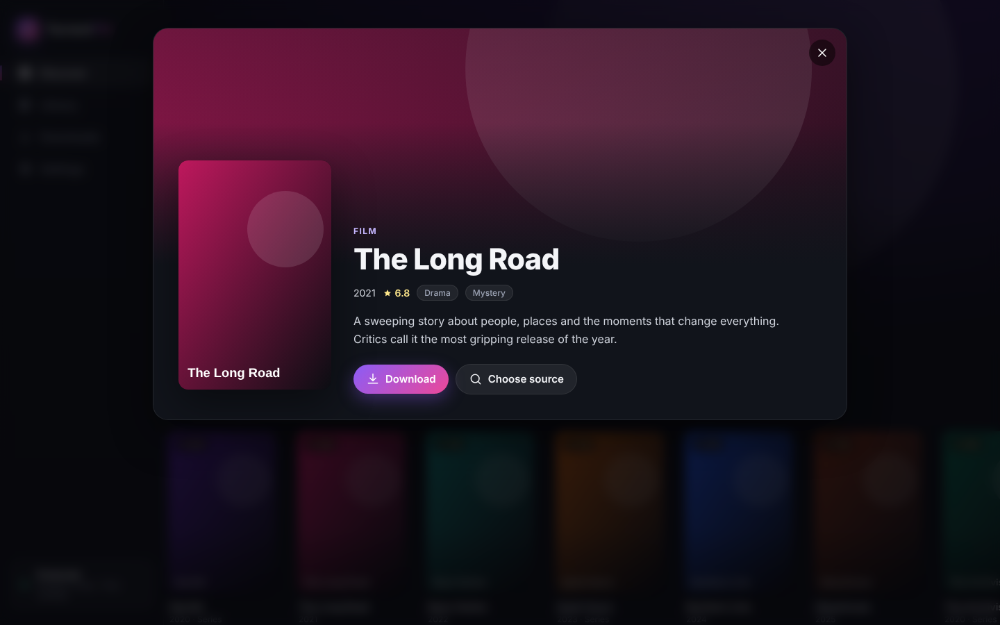
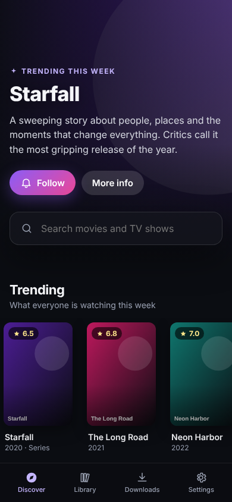

# Torrent TV

Pick the shows and films you love. Torrent TV downloads them, fetches new episodes automatically as they air, shows posters and details for everything, and checks every file before it reaches you.

Runs in any modern browser (installable as an app on Chromebooks) and as a desktop app for Windows, Mac and Linux, from one codebase.



| Title details | On a phone |
|---|---|
|  |  |

<sub>Screenshots use sample artwork.</sub>

## Features

- **Discover**: trending titles, instant search, and a shelf of free public-domain classics you can download right away.
- **Follow shows**: new episodes download on their own (checked every few hours). Or grab a whole series from episode one.
- **Artwork and info**: posters, backdrops, ratings, genres and episode lists from [TMDB](https://www.themoviedb.org/).
- **Safe by default**: file allowlist, quarantine, content verification, antivirus scan, VPN kill switch. See [SECURITY.md](SECURITY.md).
- **Your data stays local**: library and settings live on your device only.

## Sources

Built in: **Internet Archive**, which hosts thousands of public domain films and classic TV episodes with official, verified torrents.

Advanced: add your own **Torznab** feed (the standard used by Sonarr and Radarr, usually through a self-hosted Prowlarr or Jackett). Torrent TV doesn't ship or recommend any indexers; you choose what to connect and are responsible for downloading only content you have the right to. Results from your feeds pass the same safety checks, plus a minimum-seeders bar.

## Getting started

```bash
npm install
npm run dev          # web app at http://localhost:5173
npm run desktop      # desktop app
npm test             # unit tests
npm run dist         # build installers into release/
```

Then open **Settings** and paste a free TMDB API key from <https://www.themoviedb.org/settings/api> to turn on search, artwork and episode tracking.

For virus scanning in the desktop app, have Microsoft Defender on (Windows, default) or install ClamAV:
- Mac: `brew install clamav`
- Linux / Chromebook: `sudo apt install clamav`

### Hosting the web version

`npm run build` writes a static site to `dist/`. Serve it over HTTPS from any static host.

### Chromebook

Use the web version and choose **Install Torrent TV** from Chrome's menu, or enable Linux on the Chromebook and install the `.deb` from `npm run dist` for the full desktop app (antivirus and VPN checks).

## Project layout

```
src/core/            shared logic (no UI)
  safety.ts          file allowlist and trusted-link checks
  sniff.ts           real-content verification
  follow.ts          which episodes to fetch
  library.ts         library state, persistence
  metadata/tmdb.ts   artwork and info
  sources/           Internet Archive, Torznab, source registry
  engine/            torrent engine: in-browser or via the desktop app
src/ui/              React interface
electron/            desktop shell: torrent engine, quarantine, antivirus, VPN kill switch
```
