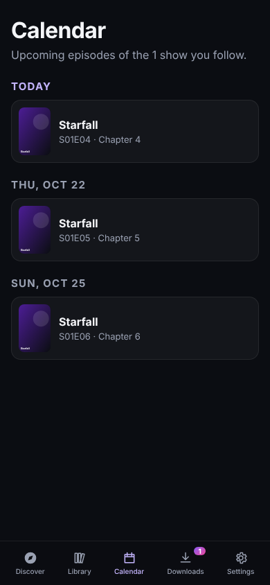
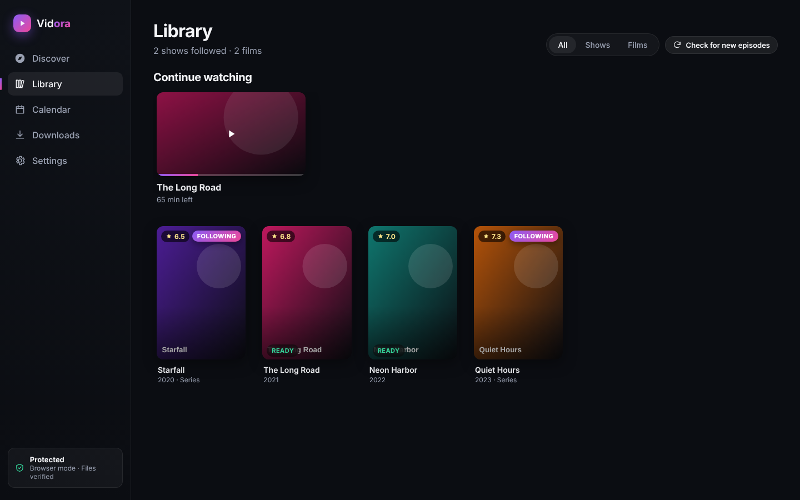

# Vidora

Pick the shows and films you love. Vidora downloads them, fetches new episodes automatically as they air, shows posters and details for everything, and checks every file before it reaches you.

Use it in any browser (and install it to your phone's home screen), or download the app for **Android, Windows, Mac, Linux and Chromebook**.

## Get Vidora

| Your device | Quickest way | Full app | Step by step |
|---|---|---|---|
| Any browser | Open **https://davidrowell11.github.io/vidora/** | | [Browser](docs/INSTALL.md#in-any-browser) |
| Android phone (e.g. Samsung Galaxy) | Open the web app in Chrome → ⋮ → **Install app** | `Vidora-android.apk` from [Releases](https://github.com/davidrowell11/vidora/releases/latest) | [Android](docs/INSTALL.md#android-phone-or-tablet-eg-samsung-galaxy) |
| Windows PC | Open the web app in Chrome or Edge → **Install** | `Vidora Setup x.y.z.exe` | [Windows](docs/INSTALL.md#windows) |
| Mac | Open the web app in Chrome → **Install**, or Safari → File → **Add to Dock** | `Vidora-x.y.z-arm64.dmg` (Apple M1 or newer) | [Mac](docs/INSTALL.md#mac) |
| Chromebook | Open the web app in Chrome → **Install** | `.deb` via Linux | [Chromebook](docs/INSTALL.md#chromebook) |
| Linux | Open the web app | `.deb` or `.AppImage` | [Linux](docs/INSTALL.md#linux) |
| iPhone / iPad | Safari → Share → **Add to Home Screen** | | [iPhone](docs/INSTALL.md#iphone-or-ipad) |

Then open **Settings** in Vidora and paste a free TMDB key to turn on search and artwork. **[Full install guide for every device →](docs/INSTALL.md)**

> The web address and the downloads go live once the repository owner has done the one-time [publishing steps](docs/INSTALL.md#for-the-repository-owner-publishing).


| Title details | On a phone | Calendar |
|---|---|---|
|  |  |  |



<sub>Screenshots use sample artwork.</sub>

## Features

- **Discover**: trending, new films, new TV shows, airing this week, instant search, and free public-domain classics you can download right away.
- **Browse & filter**: every film or show, filtered by genre, year, rating and language, sorted by popular, newest or top rated.
- **Follow shows**: new episodes download on their own (checked every few hours). Or grab a whole series from episode one.
- **You choose what downloads**: nothing is fetched unless you press Download or Get, or follow a show. Unfollow and its episodes stop. Films can be saved to your library without downloading.
- **Artwork and info**: posters, backdrops, ratings, genres and episode lists from [TMDB](https://www.themoviedb.org/), filled in for every title in your library (free classics are matched to TMDB too).
- **Media-player ready (desktop)**: downloads are filed as `Films/Title (Year)/` and `TV/Show/Season 01/Show S01E02.mp4`, with `poster.jpg`, `fanart.jpg` and `.nfo` info files that Plex, Jellyfin and Kodi read.
- **Built-in player**: resumes where you stopped and turns on subtitles in your language automatically. A "Continue watching" row takes you straight back in.
- **Quality settings**: preferred resolution (480p to 4K) and a maximum file size. Phones default to 720p.
- **Calendar**: upcoming episodes for every show you follow.
- **Watched tracking**: episodes are marked watched as you finish them, with optional **Trakt** sync so your history follows you everywhere.
- **Storage cleanup**: delete episodes (and optionally films) automatically after you've watched them. Delete any download yourself at any time.
- **Notifications**: get told when a new episode is ready to watch.
- **Safe by default**: file allowlist, quarantine, content verification, antivirus scan, VPN kill switch. See [SECURITY.md](SECURITY.md).
- **Your data stays local**: library and settings live on your device only.

## Sources

Built in: **Internet Archive**, which hosts thousands of public domain films and classic TV episodes with official, verified torrents.

Advanced: add your own **Torznab** feed (the standard used by Sonarr and Radarr, usually through a self-hosted Prowlarr or Jackett). Vidora doesn't ship or recommend any indexers; you choose what to connect and are responsible for downloading only content you have the right to. Results from your feeds pass the same safety checks, plus a minimum-seeders bar.

## For developers: run from source

You only need this to work on the code. To just use Vidora, see [Get Vidora](#get-vidora).

```bash
npm install
npm run dev          # web app at http://localhost:5173
npm run desktop      # desktop app
npm test             # unit tests
npm run dist         # build desktop installers into release/
npm run android:apk  # build the Android APK (needs Android Studio / SDK)
```

Release builds for every platform are made by the **Release apps** GitHub Action; the web app is published to GitHub Pages on every push to `main`.

Then open **Settings** and paste a free TMDB API key from <https://www.themoviedb.org/settings/api> to turn on search, artwork and episode tracking.

For virus scanning in the desktop app, have Microsoft Defender on (Windows, default) or install ClamAV:
- Mac: `brew install clamav`
- Linux / Chromebook: `sudo apt install clamav`

### Hosting the web version

`npm run build` writes a static site to `dist/`. Serve it over HTTPS from any static host.


## Project layout

```
src/core/            shared logic (no UI)
  safety.ts          file allowlist and trusted-link checks
  sniff.ts           real-content verification
  follow.ts          which episodes to fetch
  library.ts         library state, persistence
  metadata/tmdb.ts   artwork and info
  sources/           Internet Archive, Torznab, source registry
  engine/            torrent engine: in-browser or via the desktop app
src/ui/              React interface
electron/            desktop shell: torrent engine, quarantine, antivirus, VPN kill switch
android/             Android app (Capacitor) wrapping the web app
```
